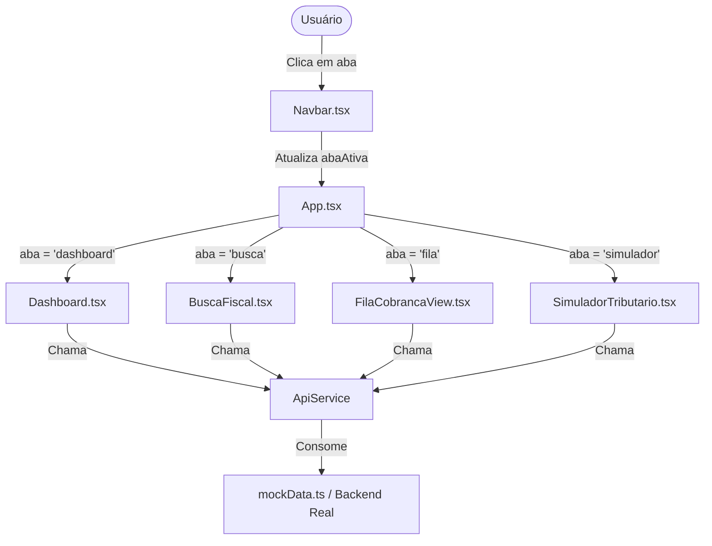

# Arquitetura e Fluxo de Dados do Frontend

## 1. Estrutura de Diretórios Explicada

```text
frontend/
├── docs/                         # Documentação técnica detalhada (exclusiva do frontend)
├── public/                       # Arquivos estáticos servidos diretamente (ícones, logos)
├── src/
│   ├── components/               # Componentes reutilizáveis compartilhados
│   │   └── Navbar.tsx            # Cabeçalho institucional e abas de navegação
│   ├── pages/                    # Telas principais da aplicação
│   │   ├── Dashboard.tsx         # Visão geral de KPIs e destaques da arrecadação
│   │   ├── BuscaFiscal.tsx       # Consulta por CPF/CNPJ e dossiê imobiliário
│   │   ├── FilaCobrancaView.tsx  # Fila ordenada pelo Max-Heap de risco
│   │   └── SimuladorTributario.tsx # Simulador de alíquotas e comparação de cenários
│   ├── services/                 # Camada de comunicação com dados
│   │   ├── api.ts                # Métodos de consulta, busca e simulação
│   │   └── mockData.ts           # Dataset realista espelhado de seeds/mock_data.py
│   ├── types/                    # Tipagens TypeScript do domínio
│   │   └── tributario.ts         # Interfaces de Contribuinte, Imóvel, Dívida, etc.
│   ├── App.tsx                   # Componente raiz, controle de rotas por aba e estado global
│   ├── main.tsx                  # Ponto de entrada React (ReactDOM.createRoot)
│   └── index.css                 # Importação do Tailwind CSS v4 e estilos globais
├── index.html                    # Página HTML principal com título e viewport
├── package.json                  # Dependências e scripts npm
├── tsconfig.json                 # Configurações do compilador TypeScript
└── vite.config.ts                # Configuração do Vite com plugin React e Tailwind
```

---

## 2. Camadas da Aplicação

### A) Camada de Apresentação (`src/pages` e `src/components`)
* **Componentes Funcionais:** Todos os componentes utilizam a sintaxe de funções com Hooks do React (`useState`, `useEffect`).
* **Responsividade:** Layouts fluidos baseados no sistema de grid e flexbox do Tailwind CSS, adaptando-se tanto a monitores de alta resolução quanto a telas de notebooks ou tablets.

### B) Camada de Serviços (`src/services`)
* **Isolamento de Requisições:** Nenhuma página faz chamadas diretas a URLs ou manipula dados brutos diretamente. Todas as operações passam por `ApiService`.
* **Transparência de Fonte:** O `ApiService` simula delay de rede real (300ms) para renderizar estados de loading coerentes e está preparado para alternar entre dados em memória e chamadas `fetch`/`axios` com apenas uma alteração de flag.

### C) Camada de Tipagem (`src/types`)
* **Segurança de Tipos:** O TypeScript com `verbatimModuleSyntax` garante que cada campo retornado pelo backend (seja uma `Divida`, um `Processo` ou um `Contribuinte`) seja estritamente validado em tempo de compilação, eliminando erros comuns de `undefined` ou digitação incorreta de propriedades.

---

## 3. Fluxo de Dados e Navegação



1. O estado de navegação (`abaAtiva`) reside em `App.tsx`.
2. Ao clicar em um contribuinte na Fila de Cobrança ou no Dashboard, o sistema passa o CPF/CNPJ diretamente para a tela de `BuscaFiscal.tsx`, abrindo o dossiê fiscal imediatamente.
